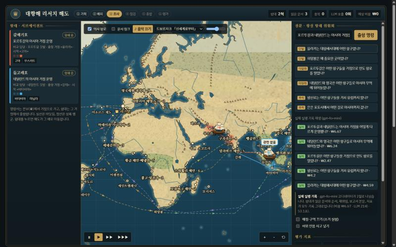

# 대항해 딥리서처

> **바로 보기** — [대항해 리서치 해도](https://voyage-deep-researcher.onrender.com/) · [보고서 대조대](https://voyage-deep-researcher.onrender.com/compare.html)
> (무료 서버라 한동안 아무도 안 들어오면 잠듭니다. 첫 접속은 30초쯤 걸릴 수 있어요.)

대항해시대 항구 문서 134건(컨텍스트의 2.58배)을 **코디네이터 하나 + 리서처 여럿**이 나눠 읽고 장문 보고서를 쓰는 LangGraph 에이전트입니다. 리서처는 세계 해도 위의 함대로, 문서는 항구로 그려집니다.



## 흐름

질문 → ① 기획(목차·역할·시작 문서) → ② 배치(리서처 동시 파견) → ③ 각자 읽고 절 쓰기 → ④ 점검(부족한 절만 재위임) → ⑤ 종합 → ⑥ 평가(정답표 없는 지표)

자세한 설계와 실험 결과는 [REPORT.md](REPORT.md)에 있습니다.

## 설치

Python 3.12 기준입니다.

```bash
python -m venv .venv
.venv/Scripts/pip install -r requirements.txt
```

(macOS·Linux는 `.venv/bin/pip`)

## 실행

**가짜 모델로 돌려 보기 (0원, 키 필요 없음)**

```bash
.venv/Scripts/python graph.py --qid Q4 --fake
```

**실제 모델 (gpt-4o-mini)** — 환경 변수 `OPENAI_API_KEY`를 쓰거나, `.env` 파일 경로를 줍니다. 키는 저장소에 올리지 않습니다.

```bash
.venv/Scripts/python graph.py --qid Q4 --env path/to/.env
.venv/Scripts/python graph.py --question "은은 포토시에서 어떤 길로 아시아까지 갔나?" --env path/to/.env
```

**단일 에이전트 대조군 (같은 읽기 예산)**

```bash
.venv/Scripts/python baseline.py --qid Q4 --env path/to/.env
```

**소거 실험** — 예상 비용을 먼저 보여 주고, `--yes`를 붙여야 실제로 돌립니다.

```bash
.venv/Scripts/python ablation.py --env path/to/.env
.venv/Scripts/python ablation.py --env path/to/.env --yes
```

**데모 (`app.py`)** — 해도를 띄우고, 새 질문을 실제 LLM으로 돌립니다. 끝난 실행은 기록에 남아 언제든 다시 재생할 수 있습니다.

```bash
.venv/Scripts/python app.py --env path/to/.env
```

브라우저에서 `http://127.0.0.1:8000`을 엽니다.

- 질문을 고르면 그동안의 실제 실행 기록(조건·시각·근거율·비용)이 나오고, 누르면 그대로 재생합니다.
- 새 질문을 적어 **출항 명령**을 누르면 실제 파이프라인이 돌고, 끝나면 바로 재생합니다.
- 비용 보호: 한 번에 하나만 실행, 실행 1회 상한 ₩150, 서버 하루 상한 ₩300(`DAILY_WON`), 접속자당 하루 3회(`RUNS_PER_IP`).

키 없이 열면(`python -m http.server 8777 --directory concepts`) 기록 재생만 됩니다. 보고서 대조대는 `concepts/compare.html`입니다.

**서버에 배포할 때** — 키는 저장소나 페이지에 넣지 말고, 호스팅 서비스의 비밀 환경 변수로만 줍니다. Render는 `render.yaml`(블루프린트)로 만들 수 있고, `OPENAI_API_KEY`는 만들 때 Render 화면에서 입력합니다.

```bash
OPENAI_API_KEY=... HOST=0.0.0.0 PORT=8000 python app.py
```

**화면 다시 만들기** — 실행 기록을 해도·대조대에 다시 싣습니다.

```bash
.venv/Scripts/python tools/build_voyage_map.py
.venv/Scripts/python tools/build_compare.py
```

## 폴더

| 경로 | 내용 |
|---|---|
| `data/` | `corpus.json`(문서·링크) · `places.json`(좌표·권역) · `questions.json`(질문 10건과 "왜 나눌 만한가") · `seagrid.json`(해로 격자) |
| `config.json` | 절 수 · 절 예산 · 라운드 상한 · 역할 명단 · 스위치 · 비용 상한 |
| `graph.py` | 기획 → 배치 → 리서처 → 점검 → 종합 → 평가 |
| `metrics.py` | 지표 (정답표 없음) |
| `ablation.py` · `baseline.py` | 소거 실험 · 단일 에이전트 대조군 |
| `app.py` | 데모 서버 (기록 재생 + 새 질문 실제 실행) |
| `output/` | `runs/`(실행 기록) · `reports/`(보고서) · `ablation.md`·`ablation.json` · `human_compare.md` · `spend.json` |
| `concepts/` | 해도(`voyage-map.html`)와 보고서 대조대(`compare.html`) |
| `tools/` | 코퍼스 수집, 해로 격자(Node), 화면 빌드 스크립트 |

## 결과 요약

- 48회 소거 실험: 1회 ₩4.35, 입력의 74%가 프롬프트 캐시에 맞음. 코디네이터가 본 글자는 전체의 25.5%.
- 지표 차이는 잡음(평균 13점) 안에 있었고, 사람이 읽어 보니 멀티 에이전트가 단일 에이전트보다 대체로 나았습니다.
- 근거율이 가장 높은 보고서가 읽기에는 가장 약했습니다. 지표는 실패를 거르는 데만 씁니다.
