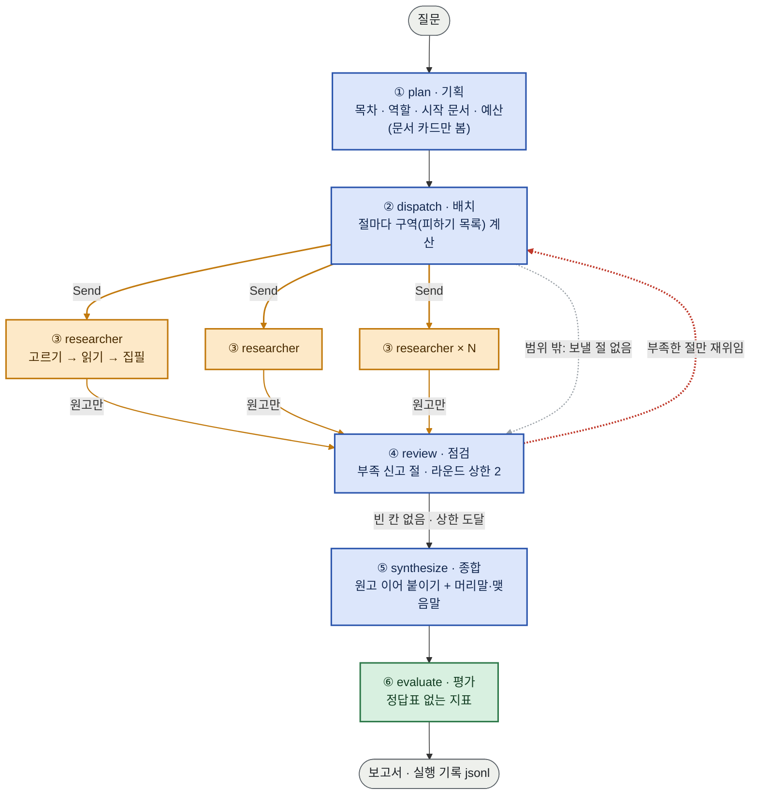
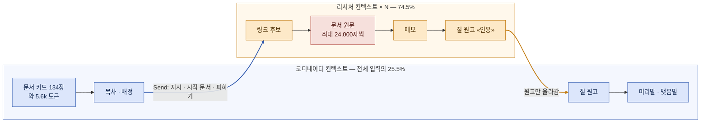
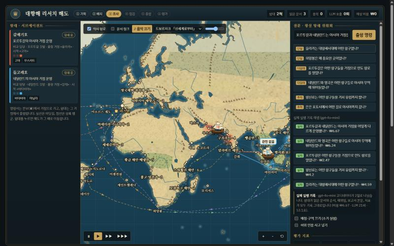
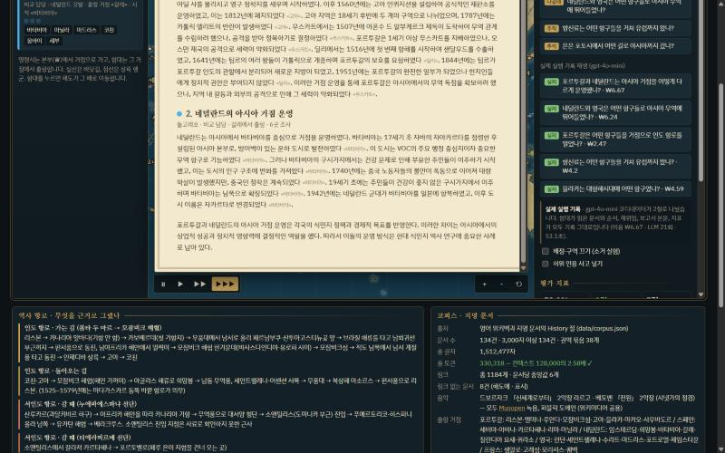
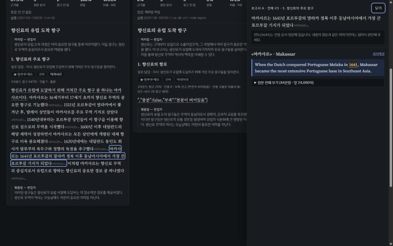

# 대항해 딥리서처 — REPORT

대항해시대 항구 문서 134건을 코디네이터 하나와 리서처 에이전트 여럿이 나눠 읽고 장문 보고서를 쓰는 LangGraph 파이프라인. 리서처는 세계 해도 위의 **함대**로, 문서는 **항구**로 그려서 누가 무엇을 읽고 썼는지를 지도에서 본다.

**한눈에**

- 코퍼스는 134건, 330,318 토큰이다. gpt-4o-mini 컨텍스트(128,000)의 2.58배라 한 번에 다 넣을 수 없다.
- 코디네이터는 문서 카드만 본다. 코디네이터가 본 글자는 전체 입력의 평균 25.5%다(단일 에이전트는 100%).
- 소거 실험은 4문항 × 6조건 × 2회 = 48회를 돌렸다. 비용은 ₩209, 1회 ₩4.35이고 입력의 74%가 프롬프트 캐시에 맞았다.
- 지표로는 장치 사이의 차이가 잡음(같은 조건 두 번 사이 평균 13점) 안에 있었다. 사람이 읽어 보니 멀티 에이전트(전체·재위임 끔)가 단일 에이전트보다 대체로 나았다. 근거율이 가장 높은 단일 에이전트가 읽기에는 가장 약했다.
- 누적 비용은 ₩404(할당 ₩5,000)이다.

---

## 1. 주제와 코퍼스

### 무엇을, 왜

**대항해시대(15~18세기) 항구·섬·해협·도시의 지명 문서**만 모았다. 이 주제를 고른 이유는 세 가지다.

- **지명 문서 하나가 지도 위의 한 점이다.** 리서처가 문서를 읽는 일을 함대가 항구에 들르는 일로 바로 그릴 수 있다. 분업이 눈에 보이는 데모가 이 프로젝트의 요점이었다.
- **답이 여러 문서에 흩어진다.** "네덜란드와 영국은 어떤 항구로 아시아 무역에 뛰어들었나" 같은 질문은 바타비아·마드라스·수라트·질란디아 요새를 따로 읽어야 한다.
- **문서끼리 서로를 가리킨다.** 위키백과 본문 링크 가운데 코퍼스 안의 지명으로 가는 것만 남겼다. 리서처는 이 링크를 따라 다음 문서를 찾는다.

### 출처와 수집

- 영어 위키백과 지명 문서의 **History 절**을 썼다(`tools/build_corpus.py`).
- 처음에는 한국어 위키백과를 썼다. 지명 54건, 98k 토큰, 링크 중앙값 1이라 "컨텍스트를 넘는다"와 "서로 가리킨다"를 둘 다 채우지 못했다.
- History 절이 3,000자보다 짧으면 문서 전체를 쓴다(20건). 그래도 3,000자가 안 되는 문서는 뺐다.
- 키는 한국어 지명이고, 보고서도 한국어로 쓰며 인용은 «한국어 지명»으로 단다. 지명 표는 `tools/places_table.py` 한 곳에서 관리한다(좌표·권역 10개·묶음 38개).

| 항목 | 값 |
|---|---|
| 문서 수 | **134건** |
| 총 글자 | 1,512,477자 |
| 총 토큰 (o200k) | **330,318** — 128,000 컨텍스트의 **2.58배** |
| 문서 하나 | 677 ~ 8,592 토큰 |
| 문서 사이 링크 | 1,184개, 문서당 중앙값 6 |
| 링크가 0개인 문서 | 8건 (사그레스·모잠비크섬·호르무즈·바스라·디우·바고·아유타야·산살바도르섬) |

링크가 0개인 문서는 탐색으로는 닿지 못한다. 코디네이터가 시작 문서로 배정하는 것이 유일한 길이다.

### 질문 세트 (`data/questions.json`, 10건)

정답표는 없다. 질문마다 "왜 나눌 만한가"를 적었고, 한 문서로 답이 나오는 질문(단일)을 일부러 넣었다.

| 번호 | 유형 | 질문 | 왜 나눌 만한가 (요약) |
|---|---|---|---|
| Q1 | 단일 | 믈라카는 대항해시대에 어떤 항구였나? | «믈라카» 한 문서에 답이 있다. 나누지 않는 편이 낫다는 대조 질문 |
| Q2 | 단일 | 희망봉은 왜 중요한 곳이었나? | 한 문서로 답이 나온다. 여럿 보내면 지표가 어떻게 나빠지는지 본다 |
| Q3 | 다갈래 | 포르투갈은 어떤 항구들을 거점으로 인도 항로를 열었나? | 거점이 서·동아프리카, 인도, 동남아에 흩어져 있다 |
| Q4 | 다갈래 | 네덜란드와 영국은 어떤 항구들로 아시아 무역에 뛰어들었나? | 두 나라 × 여러 권역 |
| Q5 | 다갈래 | 스페인은 아메리카의 어떤 항구들로 부를 실어 날랐나? | 카리브해·태평양 쪽 항구와 은광이 서로 다른 문서에 있다 |
| Q6 | 추적 | 향신료는 어떤 항구들을 거쳐 유럽까지 왔나? | 말루쿠 → 믈라카 → 인도 → 유럽 사슬을 따라가야 한다 |
| Q7 | 추적 | 은은 포토시에서 어떤 길로 아시아까지 갔나? | 포토시 → 아카풀코 → 마닐라 → 중국 |
| Q8 | 비교 | 포르투갈과 네덜란드는 아시아 거점을 어떻게 다르게 운영했나? | 두 나라 거점을 같은 잣대로 견줘야 한다 |
| Q9 | 추적 | 마젤란 원정대가 거쳐 간 항구들에서는 각각 무슨 일이 있었나? | 한 원정을 따라 여러 문서를 건너야 한다 |
| Q10 | 다갈래 | 대서양 노예 무역에 연루된 항구들은 어디였고 각각 어떤 역할을 했나? | 서아프리카·대서양 섬·아메리카 항구가 흩어져 있다 |

---

## 2. 분업 설계

### 역할 명단 (`config.json` → `roster`)

| 역할 | 맡는 일 |
|---|---|
| 항로 담당 | 배가 어느 바다를 거쳐 어디서 어디로 갔는지, 경로와 기항지를 따라간다 |
| 시간순 담당 | 언제 무엇이 일어났는지 연도와 순서를 못 박는다 |
| 원인 담당 | 왜 그 항구가 거점이 되었는지 자료에 적힌 대로 따라간다 |
| 인물 담당 | 그 항구에 관여한 사람이 무엇을 했는지 좇는다 |
| 비교 담당 | 둘 이상의 항구·나라를 같은 잣대로 견준다 |
| 큰그림 담당 | 권역 전체의 윤곽을 잡는다 (역할 끔일 때 모두 이 역할) |

### 규칙

**① 기획 (코디네이터)**
- 목차는 1~5절이다. 프롬프트로 **내용 단위**(권역·항구 무리·구간·쟁점)로 나누게 한다. 형식 단위(개요·연표·분석)로 나누면 모두가 같은 문서를 읽는다.
- 절마다 역할, 시작 문서, 읽기 예산(3건)을 준다.
- **코디네이터는 문서 본문을 보지 않는다.** 문서마다 코드로 뽑은 카드 한 줄만 본다. 카드는 `[자주 나오는 나라 머리글자] + 1480~1799년이 나오고 무역·식민 낱말이 많은 문장` 120자로, 134장에 약 5.6k 토큰이다. 처음엔 History 절 맨 앞 220자를 잘랐는데, "선사시대 암각화…" 같은 문장뿐이라 코디네이터가 판단을 못 했다.
- **배정은 코드가 검사한다.** 모델이 지어낸 이름이나 다른 절과 겹치는 시작 문서는 비슷한 실제 지명으로 바꾸고, 없으면 비운다(`fix` 사건으로 기록).
- **범위 밖 질문**(예: "한반도")에는 목차를 비우고 조사하지 않는다. 반대로 질문에 지명·나라·무역 같은 단서가 있는데 모델이 범위 밖이라 하면 한 번 되묻는다. 이 규칙이 없을 때 Q4를 범위 밖으로 오판한 적이 있다.
- **여러 곳을 묻는 질문은 최소 2절, 권역을 나눠서 (판 f).**
  - 한 절로 답해도 되는 질문은 "코퍼스 지명이 딱 하나 나오고 '들·각각·어디어디·비교·거쳐' 같은 말이 없는" 질문뿐이다(예: Q1 믈라카). 그 밖의 질문을 한 절로 짜거나, 모든 절을 같은 권역에서 시작하면 코드가 한 번 되묻는다.
  - 되물을 때는 질문에 나온 나라를 자주 언급하는 문서를 권역별로 짚어 준다. 프롬프트 규칙만으로는 gpt-4o-mini가 "스페인의 주요 항구들 / 스페인 항구의 역사적 맥락"처럼 형식으로 나누고 둘 다 유럽(세비야·카디스)에서 시작했다.
  - 고친 뒤 같은 질문("스페인의 주요 거점 항구들이 어디어디야?")이 카리브해·중남미·유럽·동남아시아·대서양 섬 5절로 나뉘었다. 같은 제목의 절이 생기면 원고가 서로 덮어쓰므로 제목도 코드가 겹치지 않게 바꾼다.

**② 배치**
- LangGraph `Send`로 절마다 리서처를 동시에 보낸다.
- **구역** = 다른 절의 시작 문서 + 다른 절이 이미 읽은 문서. 리서처는 이것을 "피하기" 목록으로 받는다.

**③ 리서처**
- 예산만큼 반복한다: 링크를 따라 후보를 만들고(막히면 코퍼스 전체), 하나를 고르고, 읽는다.
- **원문은 리서처 컨텍스트에만 있다.** 읽기 호출은 문서 원문(앞 24,000자)을 보고 한국어 메모 6문장 이내를 낸다.
- 메모만으로 절을 쓴다. 문장마다 «지명»을 붙이고, 지시를 다 채웠는지(충분/부족)를 **스스로 신고**한다.
- **인용 규율 점검:** 원고 문장의 30% 넘게 인용이 없으면 빠진 문장을 짚어 한 번 다시 쓰게 하고, 인용 비율이 나은 원고를 남긴다. 48회 동안 23번 일어났고 18번 새 원고가 채택됐다.

**④ 점검**
- **부족을 신고한 절만** 다시 보낸다. 재위임 지시에는 지난번에 읽은 문서와 비었던 내용을 덧붙인다.
- 라운드 상한은 2다. 재위임을 켠 실행 32회 중 12회가 2라운드까지 갔다.

**두 번째 원고 정책**
- 같은 절에서 원고가 두 번 올라오면 **유효 인용**(실제로 읽은 문서를 가리키는 인용) 수가 많은 쪽을 남긴다. 같으면 새 원고를 남긴다.
- 무조건 덮어쓰면, 인용을 빠뜨린 두 번째 원고가 멀쩡한 첫 원고를 지운다. 수업의 소거 실험에서 본 문제다.

**⑤ 종합**
- 절 원고는 손대지 않고 이어 붙인다. 편집자 호출은 머리말·맺음말만 쓰고, 새 사실과 인용을 금지한다.

**격리 증명**
- 모델 호출마다 입력 글자를 "코디네이터 쪽(기획·편집)"과 "리서처 쪽(고르기·읽기·집필)"으로 나눠 센다.
- 격리율 = 코디네이터 글자 / 전체 글자. 멀티 에이전트 40회 평균 **25.5%**, 단일 에이전트는 구조상 **100%**다.

**비용 장치**
- 응답의 토큰 사용량으로 원화를 누적하고, 호출 전에 상한을 확인해 멈춘다(실행 1회 ₩150, 누적 ₩4,000).
- **프롬프트 캐싱:** 매번 같은 부분(카드, 문서 원문)을 프롬프트 앞에, 매번 다른 부분(질문, 지시)을 뒤에 둔다. 캐시에 맞은 입력은 반값이다.

---

## 3. 지표 (`metrics.py`)

만든 보고서와 실제로 읽은 문서 목록만 본다. 정답표도 판정 모델도 쓰지 않는다.

| 지표 | 한 줄 뜻 | 보는 장치 | 종류 |
|---|---|---|---|
| 근거율 | 본문(절) 문장 중 «지명» 인용이 붙은 비율. 인용 금지인 머리말·맺음말은 뺌 | 조사 깊이 · 재위임 | 비교 |
| 허위 인용 | 아무 함대도 읽지 않은 문서를 인용한 수 | 집필의 근거 규율 | **경보 (0이어야 함)** |
| 엉뚱한 인용 | 코퍼스에 없는 이름을 «»로 인용한 수 | 집필 형식 | **경보 (0이어야 함)** |
| 읽고 안 쓴 문서 | 읽었지만 한 번도 인용하지 않은 문서 수 | 배정 품질 | 비교 |
| 편중 | 가장 많이 인용된 문서가 전체 인용에서 차지하는 비율 | 배정 · 구역 | 비교 |
| 중복률 | 여러 함대가 같은 문서를 다시 읽은 비율 | 배정 · 구역 | 비교 |
| 격리율 | 코디네이터가 본 글자 / 전체 입력 글자 | 컨텍스트 격리 | 비교 |

경보가 하나라도 울린 실행은 비교에서 뺀다. 지표는 명백한 실패를 거르는 데 쓰고, 어느 보고서가 나은지는 사람이 읽고 정한다(6장).

**문장 분리 규칙을 고쳤다 (과제가 경고한 "흔한 사고"를 실제로 겪음)**
- 첫 규칙은 마침표 뒤 «인용» 앞에서는 문장을 나누지 않았다. 그래서 인용을 문장 앞에 쓰는 원고(「…이다. «바타비아» 16세기 초…」)는 문단 전체가 한 문장으로 셌다. 닫히지 않은 «도 다음 »까지 수백 자를 삼켜 엉뚱한 인용 경보를 냈다.
- 지금 규칙: 문장 머리의 인용 묶음은 앞 문장 끝에 붙이고, 인용 하나는 한 줄·40자 이내로 본다. 쉼표로 묶은 «고아, 믈라카»도 나눠 센다.
- 이미 돌린 48회 전부를 **같은 새 규칙으로 저장된 보고서에서 다시 채점**했다(`ablation.py`의 `rescore`, LLM 호출 없음). 고치기 전후 숫자는 5장 표에 함께 적었다.

---

## 4. 파이프라인 구조도

### 노드와 흐름 (`graph.py`)

파란색은 코디네이터 쪽(문서 본문을 보지 않음), 주황색은 리서처(원문을 읽음), 초록색은 평가다. 주황 화살표는 `Send` 파견과 원고 반환, 빨간 점선은 재위임 고리다.

### 상태 (`Research` TypedDict)

| 필드 | 쓰는 노드 | 합치는 법 | 내용 |
|---|---|---|---|
| `question` | 입력 | — | 질문 |
| `plan` | plan · review | 덮어쓰기 | 제목, 목차(절·지시·역할·시작문서·예산), 이번 라운드에 보낼 절 번호, 라운드 수, 범위 밖 이유 |
| `sections` | researcher | **`operator.add`** (동시 반환을 이어 붙임) | 절 원고, 읽은 문서, 메모, 인용, 충분/부족, 라운드 |
| `visited` | researcher | **`operator.add`** | (절, 문서) 읽기 기록 — 중복률·허위 인용 계산 |
| `report` | synthesize | 덮어쓰기 | 최종 보고서 (마크다운) |
| `metrics` | evaluate | 덮어쓰기 | 지표 |
| `task` · `prior` | `Send` 꾸러미 | — | 리서처 한 명에게만 가는 지시(구역 포함)와 지난 라운드 원고·메모 |

### 누가 무엇을 보나 (컨텍스트 격리)

원문(빨간 칸)은 리서처 컨텍스트 밖으로 나가지 않는다.

---

## 5. 실험 — 소거와 단일 에이전트 대조군

### 설정

- 질문은 Q3·Q4·Q6·Q8이다(다갈래 둘·추적·비교). 함대가 여럿 나가야 장치 차이가 드러난다.
- 조건 6개를 각 2회 돌렸다: **전체 / 역할 끔 / 배정 끔 / 구역 끔 / 재위임 끔 / 단일 에이전트**. 모두 48회, gpt-4o-mini, temperature 0이다.
- 스위치는 실제 코드 경로를 바꾼다. 역할 끔은 모두 '큰그림 담당'이 된다. 배정 끔은 시작 문서를 비운다. 구역 끔은 피하기 목록을 비운다. 재위임 끔은 점검이 곧장 종합으로 간다.
- 비용은 ₩209, 1회 평균 ₩4.35였다. 입력 1,106,654 토큰 중 74%가 캐시에 맞았고, 캐시가 없었다면 ₩294였다.
- 질문 4개를 동시에 돌렸다. 비용 기록 파일은 프로세스 사이 잠금으로 지켰다.

**대조군이 공정한가 (`baseline.py`)**
- 같은 코퍼스, 같은 모델, 같은 읽기 프롬프트, 같은 지표와 비용 상한을 쓴다. 인용 규율 점검도 똑같이 1회 받는다.
- **읽기 예산은 짝지은 '전체' 실행이 실제로 읽은 횟수와 같다**(3~9회). 예산을 다 썼는지도 확인했다: **8회 중 8회 모두 다 썼다.** 모델이 그만 읽겠다고 하거나 없는 이름을 댄 6번은 코드가 다음 문서를 골라 줬다.
- 다른 점은 셋뿐이다. 목차와 배정이 없고, 컨텍스트가 하나(격리율 100%)이며, 보고서 전체를 한 번에 쓴다.

### 결과 (질문 4개 × 2회 평균, 경보 울린 실행 없음)

| 조건 | 근거율 | 근거율 (분리 규칙 고치기 전) | 읽은 문서 | 읽고 안 씀 | 편중 | 중복률 | 격리율 | 호출 | ₩ |
|---|---|---|---|---|---|---|---|---|---|
| 전체 | **85.2** ± 2.8 | 57.1 | 5.8 | 2.8 | 61.1 | 2.8 | 25.5 | 15.0 | 5.3 |
| 역할 끔 | 87.9 ± 11.0 | 51.5 | 5.0 | 2.1 | 57.8 | 4.2 | 25.1 | 13.1 | 4.0 |
| 배정 끔 | 91.8 ± 8.2 | 65.6 | 5.2 | 2.0 | 45.1 | 0.0 | 23.3 | 14.4 | 4.6 |
| 구역 끔 | 69.9 ± 33.2 | 48.4 | 5.8 | 2.4 | 37.5 | 2.8 | 23.3 | 15.1 | 4.2 |
| 재위임 끔 | 73.3 ± 30.4 | 51.7 | 4.2 | 1.4 | 47.3 | 4.2 | 30.4 | 11.2 | 3.4 |
| 단일 에이전트 | 85.3 ± 18.1 | 67.6 | 6.0 | 3.6 | 62.0 | 0.0 | **100.0** | 14.0 | 4.6 |

전체 표(질문별·실행별)는 `output/ablation.md`, 원자료는 `output/ablation.json`에 있다.

### 읽는 법

- **잡음이 크다.** 같은 질문·같은 조건을 두 번 돌리면 근거율이 평균 13.4점, 최대 53.8점 움직였다. 과제 안내의 "같은 설정도 시행마다 십몇 %p씩 움직인다"와 맞는다. 조건마다 8회로는 역할 끔·배정 끔이 조금 높은 것을 장치 효과라고 말할 수 없다.
- **확실히 말할 수 있는 것**
  - 격리율: 멀티 25%, 단일 100%. 설계대로 코디네이터는 원문을 보지 않는다.
  - 재위임 끔은 호출과 비용이 가장 적다(11.2회, ₩3.4).
  - 재위임 끔·구역 끔의 낮은 평균과 큰 편차는 Q6의 **빈 원고** 두 건(근거율 0%)에서 왔다. 재위임이 켜져 있으면 빈 원고를 2라운드에서 다시 채울 기회가 있다. Q6 재위임 끔 #1은 그 기회가 없어 빈 채로 끝났다.
- **분리 규칙을 고치기 전후로 순위가 바뀐다.** 고치기 전에는 단일 에이전트가 가장 높아 보였지만(67.6), 고친 뒤에는 전체와 같다(85.2 대 85.3). 지표를 바꾼 뒤에는 모든 실행을 같은 규칙으로 다시 재야 하는 이유다.

### 이 실험의 알려진 한계 (숨기지 않는다)

1. **'관련 없음' 남발 (판 d).**
   - 캐싱을 위해 읽기 프롬프트에서 지시를 문서 뒤로 옮겼다. 그 뒤 리서처가 읽은 문서의 **48%**를 '관련 없음'으로 버렸다(옮기기 전 35%). 향신료 질문에서 «말루쿠 제도»(향신료 제도)까지 버렸다.
   - 판 e에서 규칙을 "같은 지역·나라·상품·시대면 쓸 만한 사실"로 느슨하게 하고 문서 끝에 지시를 다시 적어 고쳤다. 말루쿠·고아·마데이라는 메모가 나오고, 멕시코시티(아시아 무역 질문)는 여전히 관련 없음으로 나오는 것을 확인했다.
   - **소거 실험은 판 d 결과 그대로다.** 판 e로 다시 돌리지 않았다(예상 ₩240).
2. **절이 하나뿐인 목차.** 멀티 실행 40회 중 20회는 코디네이터가 절을 하나만 만들었다. 이때는 역할·구역 장치가 일할 여지가 없다. 판 f에서 여러 곳을 묻는 질문은 최소 2절·다른 권역으로 나누게 고쳤지만(2장), 소거 실험은 그 전 판 d 결과다.
3. **반복이 2회뿐이다.** 잡음 크기를 보면 조건당 5회 이상이 필요하다.

판 기록: c(초기, 버림) → **d**(카드 축소·캐싱 순서, 소거 실험) → e(읽기 프롬프트 수정) → f(여러 곳을 묻는 질문은 최소 2절·다른 권역). 실행 기록마다 `version`이 남고, 소거 실험은 같은 판끼리만 재사용한다.

---

## 6. 사람 비교

`concepts/compare.html`(보고서 대조대)에서 같은 질문의 보고서 세 편을 나란히 읽었다. 세 편은 A 전체 #1, B 재위임 끔 #1, C 단일 에이전트 #1이다. 문장을 누르면 인용한 문서의 원문(함대가 실제로 읽은 범위)이 옆에 열린다. 메모 전문은 `output/human_compare.md`에 있다.

**판단 — 대체로 A·B(멀티 에이전트)가 낫다.**
- A·B는 나라별·권역별로 절이 나뉘어 읽기 쉽다(Q4 네덜란드/영국, Q8 포르투갈/네덜란드).
- C는 근거율이 가장 높았지만(Q4 92.3%, Q8 100%) 한두 문서로 전체를 일반화했다. Q8 C는 마카오 문서 하나로 "포르투갈은 군사보다 외교"라는 결론을 냈는데, 같은 시기 고아·무스카트 정복과 맞지 않는다.
- **근거율은 인용이 붙었는지만 보고, 맞는 문장에 붙었는지나 질문에 답했는지는 보지 않는다.**

**지표가 잡지 못한 오류 (원문 대조로 찾음)**

| 보고서 | 쓴 것 | 원문 |
|---|---|---|
| Q4 B «광저우» | 1842년 **영국이** 광저우의 특권 무역 지위를 상실 | 1842년 청-영 조약 뒤 **광저우가** 특권 지위를 잃음 |
| Q6 A «마카사르» | 1511년 **포르투갈이** 말라카에서 쫓겨난 뒤 | 1511년 포르투갈이 **말레이 상인을** 말라카에서 쫓아냄 |
| Q6 A «마카사르» | 1641년 **포르투갈의** 말라카 정복 이후 | 1641년 **네덜란드가** 포르투갈령 말라카를 정복 |
| Q8 C «바타비아» | **수단** 왕국과의 조약 | 1522년 **순다**(Sunda) 왕국과 포르투갈의 조약 |
| Q4 C «바타비아» | 영국과의 경쟁 "**이로 인해**" 바타비아가 중심지가 됨, 향신료·차·면직물 거래 | 경쟁 사실만 있고 인과는 없음, 차·면직물은 원문에 없음 |

다섯 건 모두 **연도는 원문과 맞아서** 코드 단서(연도 대조)에는 걸리지 않았다. 인용과 연도가 함께 있는 본문 문장 208개는 모두 원문에서 그 연도가 확인됐다. 주어가 뒤바뀌거나 이름을 잘못 옮긴 것은 읽어야만 잡힌다.

**마음에 안 드는 대목의 출처**
- **영문과 음차가 섞인다**(Fort St. George, Coromandel, Madraspatnam). 읽기 프롬프트가 "고유명사는 살려라"라고만 해서 메모에 영어가 남았다.
- **질문 시기 밖 이야기**(1942년 일본 항복, 19세기 광저우). 함대가 다른 문서를 '관련 없음'으로 버리고 남은 한 문서로 절을 채웠다(5장 한계 1).
- **Q3·Q6에서 항로 중간 거점이 빠졌다.** 목차가 절 하나로 끝났기 때문이다(5장 한계 2).

---

## 7. 데모 설계

### 대항해 리서치 해도 (`concepts/voyage-map.html`)

- **함대 = 리서처, 항구 = 문서.** 함대는 권역 거점에서 출항해 문서(항구)에 들러 읽고, 원고(두루마리)를 본부로 보낸다. 배 위의 금빛 고리는 "읽는 중 63%"처럼 문서를 읽는 진행을 보여 준다.
- **절마다 누가 무엇을 읽고 썼는지** 왼쪽 함대 목록과 항구 칩, 오른쪽 기록으로 보여 준다. 함대가 '관련 없음'으로 버린 문서, 재위임 재출항, 코드가 바로잡은 배정도 기록에 나온다.
- **화면은 실제 LLM 실행만 보여 준다.** 처음에는 LLM 없이 흐름을 흉내 내는 시뮬레이션도 있었지만, 실제 결과와 헷갈려서 뺐다.
- **실행 기록 재생.** `graph.py`·`baseline.py`가 남긴 `output/runs/*.jsonl`을 모두 싣는다(지금 69개).
  - 질문 10개 중 하나를 고르면 그 질문의 실행 목록이 조건(전체·장치 끔·단일 에이전트), 시각, 코드 판, 근거율, 비용과 함께 나온다. 하나를 누르면 읽은 순서, 재위임, 보고서 원문, 지표까지 기록 그대로 재생한다.
  - 아직 실행 기록이 없는 질문은 "기록 없음"으로 흐리게 보인다. 단일 에이전트 기록은 목차 없이 함대 한 척으로 재생한다.
- **새 질문 실제 실행 (`app.py`).**
  - `app.py`로 열면 질문 칸이 켜진다. 질문을 보내면 서버가 실제 `graph.py`를 돌리고, 화면은 실행 기록 파일을 1.2초마다 읽어 기획·읽기·원고·점검을 항해 일지에 바로 보여 준다.
  - 끝나면 그 기록을 해도에서 그대로 재생하고 실행 목록에 더한다.
  - API 키는 서버의 환경 변수에만 있고 화면으로 나가지 않는다. 비용 보호 장치: 한 번에 하나만 실행, 실행 1회 상한 ₩150, 서버 하루 상한(기본 ₩300), 접속자당 하루 3회.
  - 정적 페이지(GitHub Pages)로 열면 질문 칸은 꺼지고 기록 재생만 된다.
- **함대 따라가기.** 일하는 배(항해·읽기·집필)가 화면 가장자리 여백 안에 머물도록 시점을 천천히 옮긴다. 정중앙에 맞추지 않고 벗어나려 할 때만 민다. 확대·축소는 하지 않는다. 일하는 배들이 한 화면에 다 들어오지 않으면 지금 화면에서 가장 가까운 배 하나를 따라간다. 사용자가 끌거나 확대하면 5초 동안 손을 떼고, ⛵ 단추로 끌 수 있다.
- **옮길 때 빈 지도가 보이지 않게.** 바탕(육지·지형·역사 항로)을 화면보다 사방으로 넓게(화면의 35%, 최대 360px) 미리 그려 둔다. 끌거나 따라가기로 옮길 때는 이 그림을 옮겨 쓰고, 미리 그린 여백을 벗어나면 기다리지 않고 바로 다시 그린다.
- **보고서 화면.** 절마다 함대·역할·출항 거점·읽은 문서 수를 달았다. 인용 «지명»은 작고 흐리게 표시하고, 아무도 읽지 않은 문서를 인용하면 붉게 칠한다.

  

- **나라별 본부.** "네덜란드와 영국은…" 같은 질문이면 리스본이 아니라 암스테르담(VOC 17인 위원회)과 런던에서 함대가 나간다. 질문에 나라가 없으면 시작 문서를 가진 나라의 거점에서 출항한다.
- **범위 밖 질문**("한반도")에는 함대를 보내지 않고 이유만 보여 준다.
- **항로를 역사와 맞췄다.**
  - 배는 0.25° 바다 격자 위에서 A*로만 움직인다(웹 워커). 인도 항로, 서인도 항로, 마닐라 갈레온, 마젤란·엘카노, 브라우어 항로 등 역사 항로 13개는 사료의 기항지를 제어점으로 만들었고, 그 회랑을 따라가도록 비용을 낮췄다. 역사 항로 선분 224개 모두 육지를 지나지 않는다.
  - 북위 66° 위의 바다는 닫았다. 대항해시대에 아무도 지나가지 못한 북서항로로 길찾기가 지름길을 내던 문제를 막기 위해서다.
- **내장 그래픽 노트북에서도 매끄럽게.** 육지 바탕은 한 번 그려 캐시하고, 확대·이동 중에는 그 그림을 변환만 하다가 140ms 멈추면 다시 그린다. 글자·배·빛은 스프라이트로 재사용하고, 쉬는 중에는 초당 12장으로 줄인다.
- 배경 음악은 잔잔한 퍼블릭 도메인 녹음(Musopen) 두 곡을 셔플한다.

### 보고서 대조대 (`concepts/compare.html`)

- 같은 질문의 보고서 세 편을 나란히 놓는다. 칸마다 48회 실행 중 아무거나 고를 수 있다.
- **문장을 누르면 인용 문서 원문**이 옆에 열린다. 같은 연도가 나오는 원문 문장을 찾아 강조한다.
- 코드가 찾은 **단서**(인용 문서 원문에 없는 연도, 인용 문서가 거의 말하지 않는 나라)는 노랗게 표시하지만 판정은 하지 않는다.
- 사람 판단 메모를 적어 마크다운으로 복사할 수 있다.

### 실행 방법

README에 적었다. `python app.py --env <.env 경로>`로 띄우면 새 질문까지 되고, `python -m http.server`로 열면 기록 재생만 된다.

---

## 8. 프로젝트 회고

### 가장 공들인 부분

- **분업이 눈에 보이게.** 숫자만 보여 주는 화면은 이 프로젝트의 요점을 놓친다는 안내를 따랐다. 문서를 지도 위 항구로 만들고, 리서처가 실제로 읽은 순서대로 함대가 바닷길을 따라 움직이게 했다. 항로가 육지를 가로지르거나 북극을 지나지 않도록 해로 격자·역사 항로·검증 스크립트를 만들었다.
- **예산 안에서 실험하기.** 할당이 ₩5,000이라 개발은 가짜 모델(0원)로 했다. 지표는 저장된 기록으로 다시 계산하고, 캐싱과 카드 축소로 1회 비용을 ₩8~10에서 ₩4.35로 줄였다. 누적 ₩404.
- **에이전트 결과를 의심하기.** 과제가 경고한 사고 셋을 모두 실제로 겪었다.
  - 문장 분리 규칙 때문에 근거율이 잘못 나왔다. 고친 뒤 전부 다시 채점했다.
  - 프롬프트 순서를 바꾸자 '관련 없음'이 늘었다. 원문과 대조해 찾았다.
  - 한 번 돌린 결과(Q4 1차)는 집필 실수 하나가 장치 효과보다 컸다. 2회 반복으로 바꿨다.

### 실수와 배운 것

- **"범위 밖이면 조사하지 말라"는 규칙이 너무 셌다.** 한반도 질문을 막으려고 넣었더니 Q4까지 범위 밖으로 오판했다. 모델 판단 위에 코드 단서(지명·나라 낱말)를 한 겹 두는 것으로 고쳤다.
- **비용 최적화가 판단을 바꿨다.** 캐싱 순서(지시를 문서 뒤로)만 바꿨는데 읽기 판단이 달라졌다. 비용을 줄이는 변경도 품질 변경으로 보고 재야 한다.
- **근거율 순위 ≠ 좋은 보고서.** 사람 비교에서 근거율 최고인 단일 에이전트가 가장 약했다.

### 앞으로 보완할 것

1. **실행 중에도 함대를 움직이기.** 지금은 실행 중에는 항해 일지만 실시간으로 채우고, 함대 애니메이션은 실행이 끝난 뒤 재생한다. 사건이 들어오는 대로 함대를 움직이면 기다리는 시간이 덜 지루하다.
2. **판 f로 소거 실험 다시 하기**(조건당 5회 이상). '관련 없음' 문제와 한 절 목차를 고친 뒤의 장치 효과를 보고 싶다.
3. **고유명사 표기 규칙.** 한국어 음차를 쓰고 처음 나올 때만 괄호에 원어를 단다.
4. **오귀속 단서 늘리기.** 연도만으로는 하나도 못 잡았다. 주어(나라)·사건 동사를 원문과 맞추는 가벼운 대조를 더할 수 있다.
